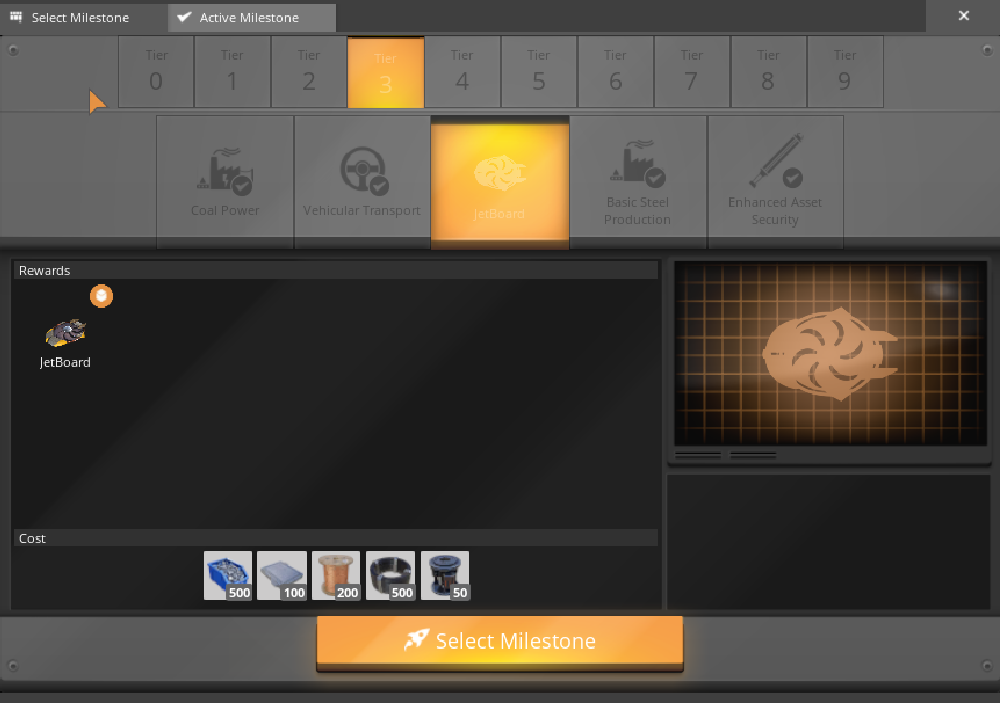
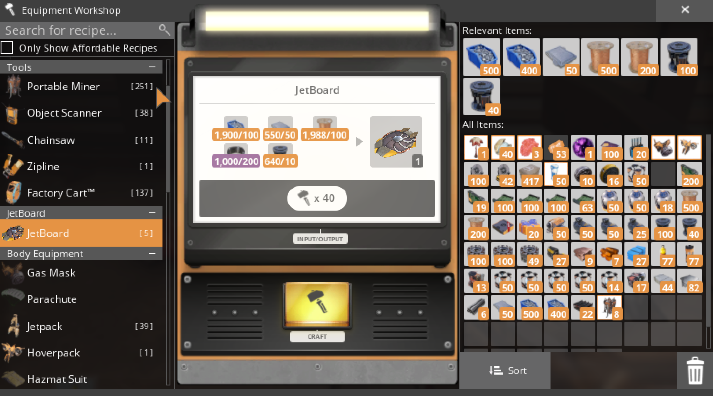
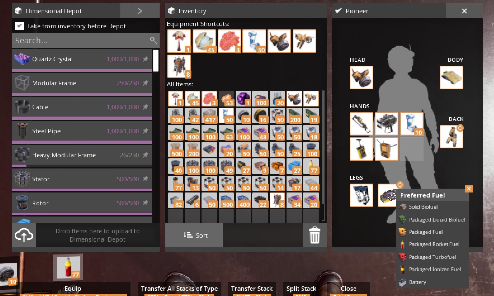

# JetBoard Mod for Satisfactory (beta)

This mod brings the [JetBoard](https://jakanddaxter.fandom.com/wiki/JET-Board) from the [Jak & Daxter series](https://jakanddaxter.fandom.com/wiki/Jak_and_Daxter_series) into [Satisfactory](https://www.satisfactorygame.com).

https://github.com/user-attachments/assets/6b5d6c62-1832-4bbd-8d20-2bc956a91945

It's particularly inspired by my love for [Haven Forest](https://youtu.be/rxbE-NjpPuY) in Jak II. The beautiful atmosphere has stayed with me since a kid, and as a huge fan of Satisfactory, I thought why not have some fun combining them. It's also inspired by the great work the [OpenGOAL](https://opengoal.dev/) team is doing. All original design credits go to [Naughty Dog](https://www.naughtydog.com). See [credits](Credits.md) for more details.

## How to install this mod

1. Head to the [releases](https://github.com/jonzo84/jetboard-satisfactory/releases) page and download the latest release.
2. Extract the ZIP.
3. Close Satisfactory and Satisfactory Mod Manager.
4. Open `START SETUP.cmd`.
5. In the dropdown, select your Satisfactory install location if it's not auto-selected, eg `C:\Program Files (x86)\Steam\steamapps\common\Satisfactory`.
6. Click **Install / Repair**.
7. When files are verified, click **Launch** (or just open Satisfactory from Steam).

## How to access the JetBoard in Satisfactory

1. Unlock it from the HUB in Tier 3.

2. Build the JetBoard in the Equipment Workshop.

3. Equip the JetBoard in your second leg slot. You can wear Blade Runners normally.

4. Make sure you've got fuel! Just like with the Jet Pack, the higher the energy density, the faster you'll go.

| Fuel | Top speed | Movement time per item |
|---|---:|---:|
| Solid Biofuel | 8 m/s | 5 seconds |
| Packaged Liquid Biofuel | 9.6 m/s | 10 seconds |
| Packaged Fuel | 11.2 m/s | 15 seconds |
| Packaged Rocket Fuel | 12.8 m/s | 20 seconds |
| Packaged Turbofuel | 14.4 m/s | 25 seconds |
| Packaged Ionized Fuel | 16 m/s | 30 seconds |
| Battery | 17.6 m/s | 35 seconds |

---

## Troubleshooting

If Windows blocks a downloaded script, right-click the downloaded ZIP, select **Properties**, tick **Unblock** if shown, **Apply**, then extract it again. Do not change your machine's PowerShell execution policy.

Setup uses the bundled SML 3.12.0 ZIP when included, checking its checksum first. Smaller download-only bundles fetch SML from its official GitHub release when needed. Approve the Windows permission prompt only when installing to a protected folder.

If the download fails: retry **Install / Repair**, or download the
[official SML Windows ZIP](https://github.com/satisfactorymodding/SatisfactoryModLoader/releases/download/v3.12.0/SML-Windows.zip). Click **Select SML ZIP** and choose it. Setup verifies it automatically.

**Verify** checks installed files. After a fresh launch from setup, click **Verify** again at the main menu to check startup markers.

Click **Collect diagnostics**, then **Open log location**. Review the single `.log` file. Logs may contain game paths and selected gameplay/network errors. Home-directory names and IPs are redacted.

## In game

Press enter to open Chat, then type `/hoverboard` and hit enter again. This will equip the board in your back slot for testing. Press right mouse (secondary fire) to toggle whether it's active. Use `/hoverboard off` in chat to dismount the mod manually.

## Manual install

Close the game. **Steam > Satisfactory > Manage > Browse local files**.

| Archive | Extract contents directly into |
|---|---|
| `Hoverboard-Windows.zip` | `FactoryGame/Mods/GameFeatures/Hoverboard/` |
| `SML-Windows.zip` | `FactoryGame/Mods/SML/` |

Check that `Hoverboard.uplugin` and `SML.uplugin` sit directly in those respective folders, not in extra nested folders. Move old mod folders outside Mods before replacing them. Keep `Credits.md` with any copy you share.

---

## Credits

- See [credits](Credits.md) for more details.
